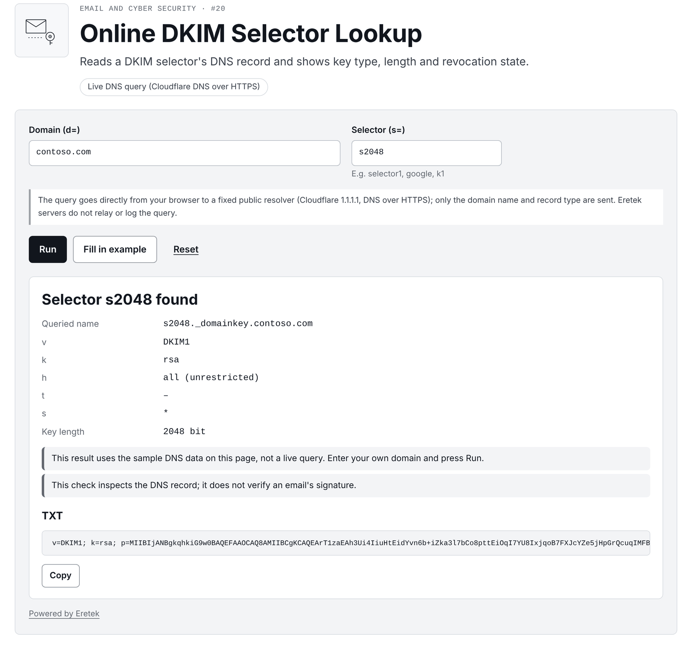

# DKIM Selector Lookup

Look up a DKIM selector record: CNAME chain, v/k/h/t tags, public key type and bit length, revoked keys (empty p=) and testing mode.

## Try it live

- [Türkçe](https://siberguvenlik.eretek.com/araclar/dkim-selector-sorgulama)
- [English](https://siberguvenlik.eretek.com/en/tools/dkim-selector-lookup)
- [Deutsch](https://siberguvenlik.eretek.com/de/werkzeuge/dkim-selektor-abfrage)



## What it does

Reads a DKIM selector's DNS record and shows key type, length and revocation state.

The `s=` (selector) and `d=` (domain) values of a DKIM signature tell the receiver where to find the public key: `selector._domainkey.domain`. The tool queries that name, shows the chain if it is delegated by CNAME (e.g. to an email provider) and decodes the key type and length.

## Where it helps

Below 2048 bits, rotate to a new selector in your provider's console; revoke the old selector a few days after mail has been delivered.

If the selector is not found (NXDOMAIN), check the `s=` and `d=` values in the email again; the DKIM `d=` may differ from the From domain.

## How to use it

1. Enter the domain and selector. Take the selector from the `s=` value of an email's DKIM-Signature header.
2. Press Run.

### Fields

| Field | Description |
|---|---|
| Domain (d=) |  |
| Selector (s=) | E.g. selector1, google, k1 |

## Example input

Press **Fill in example** in the tool to load this input.

| Input | Value |
|---|---|
| Domain (d=) | `contoso.com` |
| Selector (s=) | `s2048` |

**Expected result:** s2048._domainkey.contoso.com: v=DKIM1, k=rsa, 2048-bit RSA key; no testing mode.

## Method and assumptions

TXT is queried for `selector._domainkey.domain`; if there is a CNAME the resolver follows it and the tool shows the chain. Tags (`v, k, h, t, s, p`) are parsed.

`p=` is decoded as Base64 SubjectPublicKeyInfo; for RSA the modulus bit length is shown, Ed25519 is 256 bits. `t=y` marks testing mode.

## Limits and common mistakes

- It does not verify an email signature; it only inspects the key in DNS.
- It cannot list all selectors of a domain; DNS has no selector list.

## Run it locally

The tool is plain HTML, CSS and JavaScript with no build step and no dependencies.

```bash
git clone https://github.com/eretek/dkim-selector-lookup.git
cd dkim-selector-lookup
node scripts/serve.js        # or: python3 -m http.server 8080
```

Open <http://127.0.0.1:8080/>. Add `?lang=tr` or `?lang=de` for Turkish or German; without it the page follows the browser language and falls back to English. You can also open `index.html` directly from disk.

Run the tests (Node.js 18 or later):

```bash
node test/run.js    # or: npm test
```

The tests run the tool's own fixtures and the worked examples in all three languages without a browser.

## How it works

Everything except the DNS lookup runs in your browser. The lookup goes directly from the browser to a fixed public DNS-over-HTTPS resolver (Cloudflare `cloudflare-dns.com`, with Google `dns.google` as the second resolver in `src/lib/dns.js`); only the domain name and record type are sent. The **Fill in example** button uses sample DNS data stored in `src/data.js`, not a live query.

No server-side component is needed. The version on the Eretek website renders the same page through a private WordPress plugin; that plugin only produces the page markup and is not part of this repository.

| Path | Purpose |
|---|---|
| `index.html` | Page shell |
| `src/app.js` | Builds the page in Turkish, English or German from `src/data.js` |
| `src/data.js` | Field definitions, examples and all texts in three languages |
| `src/core.js` | Shared runtime: validation, number formats, result rendering, CSV/ICS export |
| `src/tool.js` | The calculation or analysis for this tool |
| `docs/screenshot.png` | Screenshot used in this README |
| `src/lib/asn1.js` | DER/ASN.1, PEM, X.509 and CSR reader |
| `src/lib/dns.js` | DNS-over-HTTPS client for fixed public resolvers |
| `src/tools.css`, `src/page.css` | Styles |
| `test/run.js`, `test/cases.json` | Headless tests |

## License and attribution

This tool is released under the [Eretek Website Attribution License](LICENSE). You may use, modify and redistribute it, including commercially. If you make it available on a website or web application, show a visible, clickable credit linking to https://eretek.com/ on every page where the tool is available, for example:

```html
<a href="https://eretek.com/">Powered by Eretek</a>
```

You may add `rel="nofollow"` to the link. Keep the copyright notice and license text in copies and redistributions.
